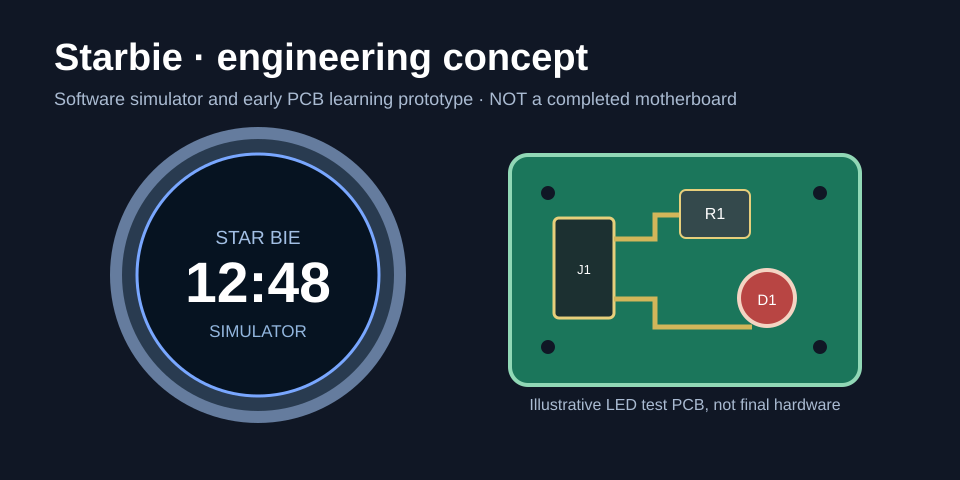

# Starbie

**Starbie** is a compact circular-screen electronics project exploring an interactive display, physical navigation buttons and a custom control board.

## Project overview

The repository contains three connected areas:

| Area | Files | Purpose |
| --- | --- | --- |
| Interactive interface | [app/](app/) | Browser-based UI simulator |
| Application logic | [firmware/starbie_core.py](firmware/starbie_core.py) | Python state-machine prototype |
| Electronics | [hardware/](hardware/) | Candidate components and KiCad learning files |

## Explore the interface

Open `app/index.html` in a browser. The simulator runs locally without a build step.

## Application logic

The Python prototype models three interface modes (clock, status, settings), screen brightness and battery-status values.

Run the unit tests:

```bash
python -m unittest discover -s tests -v
```

GitHub Actions is configured to run these tests on pushes and pull requests. Check the [Actions tab](../../actions) for execution results.

## Electronics development

The proposed architecture connects an RP2040-class controller to a circular SPI display and two buttons, with regulated power.

- [System architecture](docs/ARCHITECTURE.md)
- [Candidate bill of materials](hardware/BOM.csv)
- [Hardware design notes](hardware/README.md)
- [PCB requirements](docs/PCB_REQUIREMENTS.md)
- [Pin mapping worksheet](docs/PIN_MAPPING_TEMPLATE.csv)
- [Validation plan](docs/VALIDATION.md)

The existing KiCad files are an LED/resistor exercise. A complete Starbie board design and physical prototype are separate development milestones.

## Project process

- [Build journal template](docs/BUILD_JOURNAL_TEMPLATE.md)
- [Submission readiness checklist](docs/REVIEW_CHECKLIST.md)

## Visual direction



*Concept illustration of the intended interface and hardware direction.*
